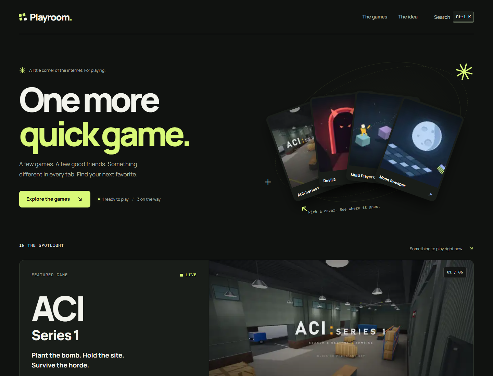

# Casey Nguyen / Games

A hub for my browser-first games, linking players straight to each game's live site.



Live: **TODO(casey): add the hub's production URL after connecting Vercel.**  
[](https://github.com/ceenguyen05/GameDemoPortfolio/actions/workflows/ci.yml)

## Games

| Game            | Status      | Play                                           |
| --------------- | ----------- | ---------------------------------------------- |
| ACI: Series 1   | Live        | [Launch game](https://aci-series1.vercel.app/) |
| Classified / 02 | Coming soon | Locked                                         |
| Classified / 03 | Coming soon | Locked                                         |

## Tech stack

Next.js App Router · strict TypeScript · Tailwind CSS · Motion · Node 22 · npm.

## Run locally

Prerequisite: Node 22 (see `.nvmrc`).

```sh
npm ci
npm run dev
npm run build
```

## Add a game

Add one entry to `src/content/games.ts` and its assets to `public/games/<slug>/`.
Routes, launch redirects, commands, and the sitemap follow the data; see [Adding a game](docs/ADDING_A_GAME.md).

## Project structure

```text
.github/        CI, Lighthouse, dependency updates
docs/           Design, content, deployment, decisions
public/         Game images and icons
scripts/        Content validation and link checks
tests/          Content contracts and browser checks
src/
  app/          Static routes and metadata
  components/   UI, layout, games, command palette
  content/      Typed game catalog
  hooks/        Dialog and sound behavior
  lib/          Validation, redirects, site config, OG
  styles/       Tokens and responsive styling
  types/        Shared content types
```

[Deploying](docs/DEPLOYING.md) · [Design](docs/DESIGN.md) · [Decisions and TODOs](docs/DECISIONS.md)

Casey Nguyen · [GitHub](https://github.com/ceenguyen05)
